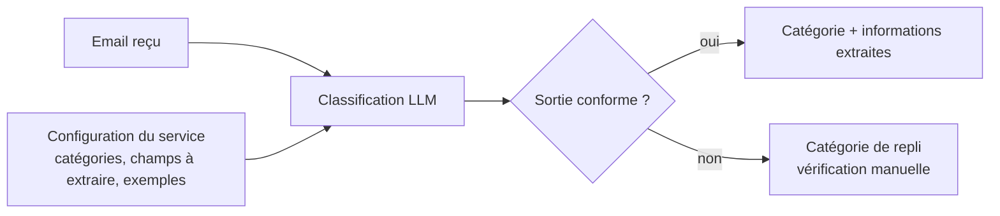
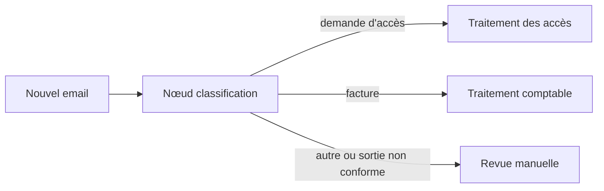

# Email classification with LLM

Certains services reçoivent chaque jour un grand volume d'emails : support, comptabilité, gestion des accès, service client. Une bonne partie du temps passe à les trier, c'est-à-dire reconnaître le type de demande, relever les informations utiles et orienter chaque email vers le bon traitement.

Ce projet automatise ce tri avec un LLM open source exécuté en local. Pour chaque email, le modèle renvoie une catégorie et les informations propres à cette catégorie. Pour une demande d'accès, par exemple : le type de demande, l'entité qui la fait et les utilisateurs concernés. Les emails ne quittent pas la machine.

## Principe

Le code ne contient rien de propre à un métier. Les catégories d'un service, les champs à extraire pour chacune et quelques exemples sont décrits dans un fichier de configuration. Pour prendre en charge un nouveau service, on écrit une nouvelle configuration sans modifier le code.

La sortie du modèle est contrainte par un schéma puis revalidée. Le modèle se limite à classer et extraire : il ne déclenche aucune action, et le contenu des emails est traité comme une donnée, jamais comme une instruction.

## Intégration

La classification s'utilise seule ou comme brique d'un projet plus large. Dans un graphe LangGraph, elle devient le premier nœud et la catégorie renvoyée détermine la suite du traitement.

## Avancement

- [x] Classification configurable par fichier
- [x] Tests unitaires
- [ ] Jeu de test étiqueté
- [ ] Comparaison de modèles open source
- [ ] Intégration dans un graphe LangGraph

Les emails et les noms présents dans le dépôt sont fictifs.